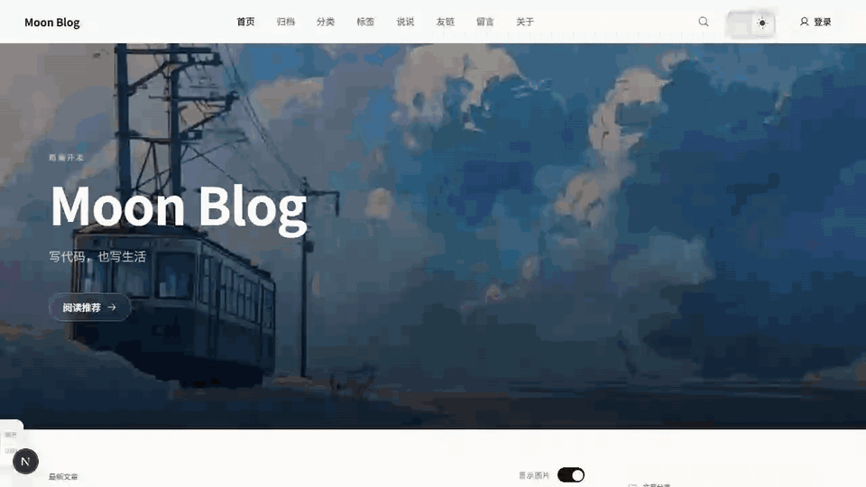
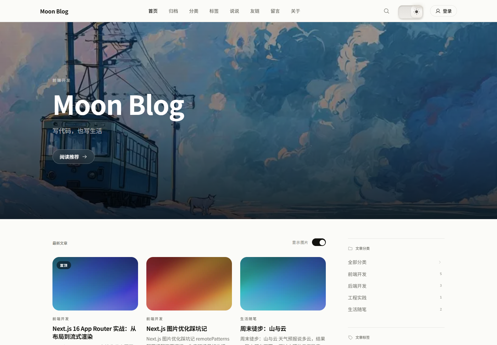
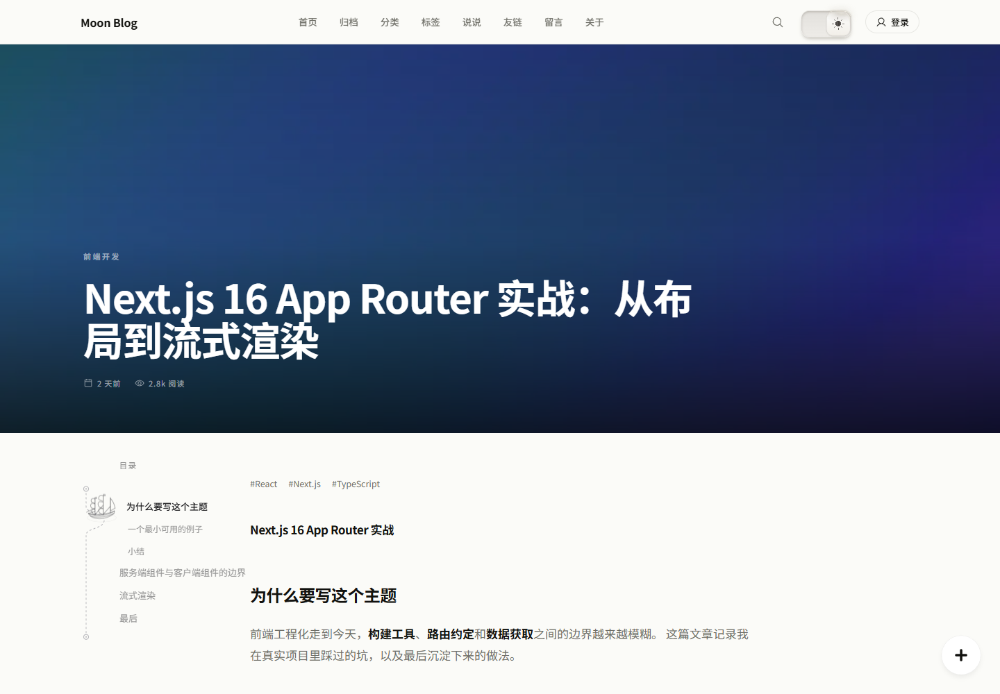
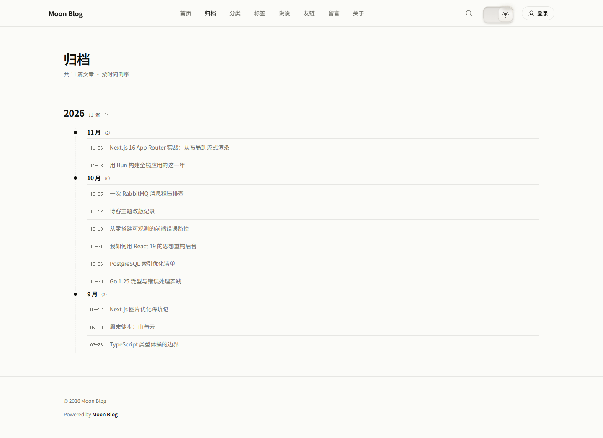
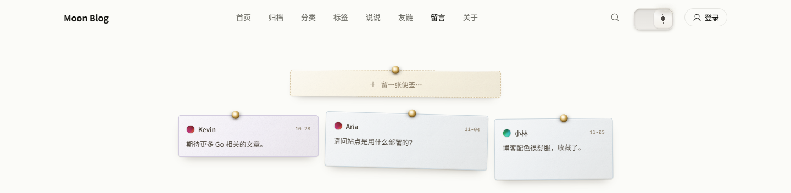
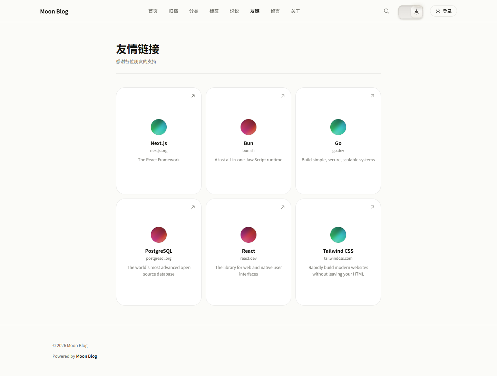
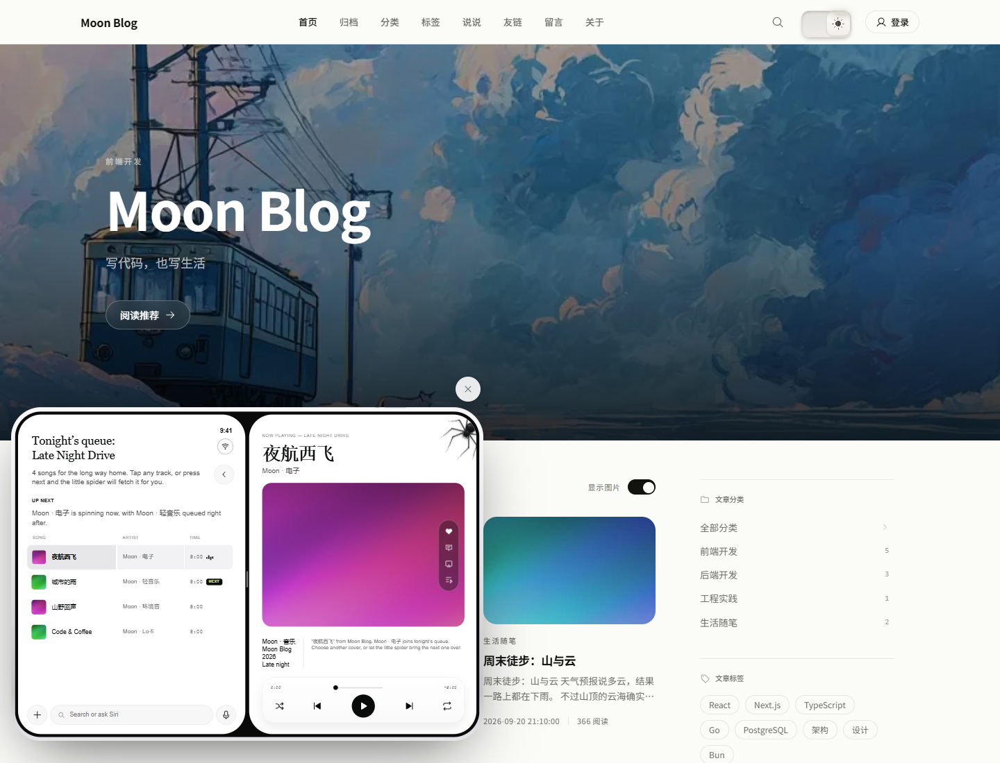
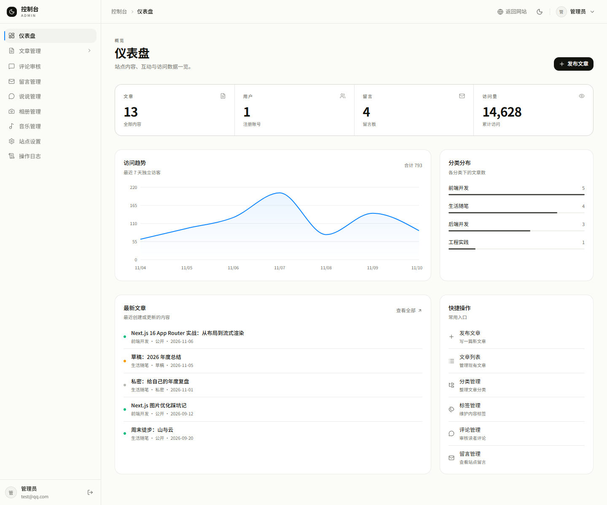
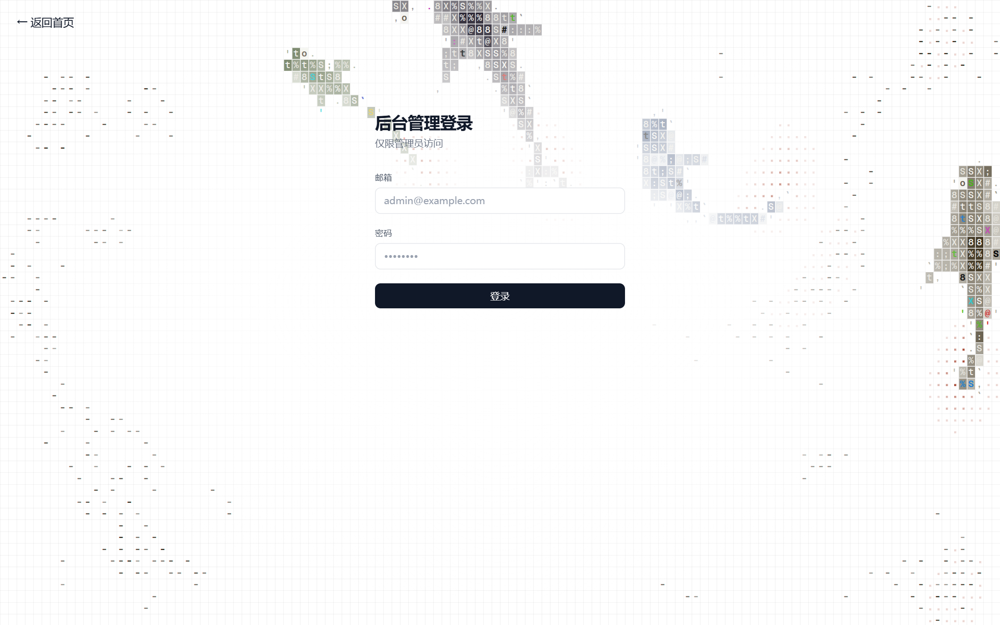
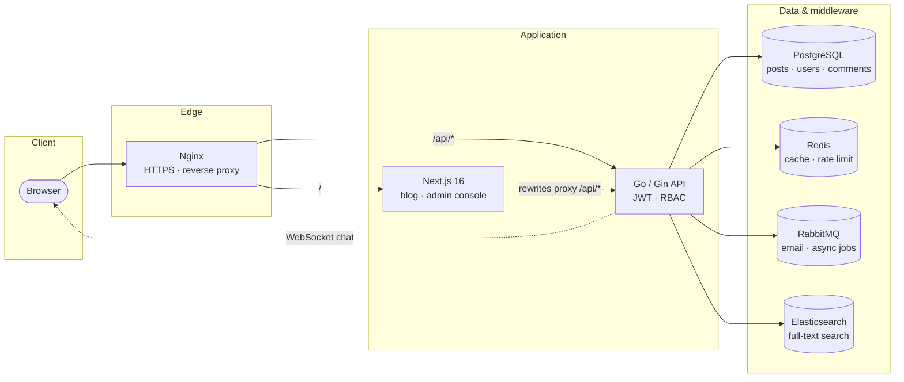

<div align="center">

# 🌙 Moon Blog

**Minimal, but not simple — a full-stack blog you can ship today, and read from top to bottom.**

[Live Demo](https://ideast.top) · [English](README.en.md) / [简体中文](README.md) · [Quick Start](#quick-start) · [Deploy](#deploy) · [Changelog](CHANGELOG.md)

[](https://ideast.top)
[](LICENSE)
[](https://nextjs.org)
[](https://react.dev)
[](https://go.dev)
[](https://www.postgresql.org)
[](https://www.docker.com)

</div>



## Why Moon Blog

**Restrained by design.** Warm paper tones, hairline rules, and typography-first
layouts — on the blog and in the admin console alike. No gradient soup, floating
cards, or pill-shaped tags competing with the words.

**Deployment without the yak-shaving.** The frontend, backend, PostgreSQL, Redis,
RabbitMQ, and Elasticsearch all live in one `docker-compose.yml`. Fill in `.env`
and bring the whole stack up with a single command. Production Nginx, HTTPS, deploy
and rollback scripts are in the repo too.

**Built to be learned from.** This is not an API-stub scaffold: JWT + Casbin
authorization, Redis rate limiting, RabbitMQ email jobs, Maxwell CDC syncing into
Elasticsearch, and WebSocket chat all run in real flows. The layers are clean enough
to read module by module, or to fork into your own blog.

## Features

**Blog**

- Hero recommendation, article feed, category / tag filters, archives, talks, guestbook, links, about
- Markdown rendering with syntax highlighting, table of contents, image lightbox, full-text search
- Light / dark themes (pixel toggle), a floating music player, responsive layout
- Comments and a guestbook, article view counts

**Admin console**

- Dashboard: article / user / message / view KPIs, 7-day traffic trend, category breakdown, latest articles
- Markdown editor, drafts and publishing, category and tag management
- Comments, guestbook messages, talks, albums, and playlist management
- Site settings (profile, social links, about page) and operation logs

**Server**

- JWT sessions with Casbin RBAC
- Redis sliding-window rate limiting, captchas, token versions, like counters
- RabbitMQ email jobs, Elasticsearch full-text search, Maxwell CDC incremental sync
- WebSocket chat and file uploads (local / OSS / COS)

## Tech Stack

| | |
| --- | --- |
| Frontend | Next.js 16 (App Router) · React 19 · TypeScript · Tailwind CSS v4 · Base UI · TanStack Table · Zustand |
| Backend | Go 1.26 · Gin · GORM · Casbin · JWT |
| Data | PostgreSQL 16 · Redis 7 · Elasticsearch 7 · RabbitMQ |
| Tooling | Docker Compose · Nginx · Playwright / Vitest · GitHub Actions |

## Screenshots

<table>
  <tr>
    <td width="50%"></td>
    <td width="50%"></td>
  </tr>
  <tr>
    <td></td>
    <td></td>
  </tr>
  <tr>
    <td></td>
    <td></td>
  </tr>
  <tr>
    <td></td>
    <td></td>
  </tr>
</table>

## Quick Start

### Option 1: Docker Compose (recommended)

Requires Docker and Docker Compose.

```bash
git clone https://github.com/imagist13/MoonCode.git
cd MoonCode

cp .env.example .env          # set JWT_SECRET, database password, etc.
docker compose up -d --build
```

Then open:

- Blog: <http://localhost:3000>
- Backend health check: <http://localhost:8080/health>
- RabbitMQ console: <http://localhost:15672> (guest / guest)

Create the first admin account:

```bash
docker compose exec -e SEED_ADMIN_EMAIL=admin@example.com \
                    -e SEED_ADMIN_PASSWORD='your-password' \
                    backend ./seed
```

Sign in at `/admin/login`.

### Option 2: Local development

```bash
# Infrastructure only
docker compose up -d postgres redis rabbitmq elasticsearch

# Backend (:8080)
cd backend
JWT_SECRET="$(openssl rand -base64 48)" go run ./cmd/server

# Frontend (:3000)
cd frontend
bun install && bun run dev
```

`next.config.ts` rewrites `/api/*` to `BACKEND_URL` (default
`http://localhost:8080`), so there is no CORS setup in local development.

Working on the frontend only? Skip Go and the databases and use the bundled mock API:

```bash
cd frontend
bun run mock    # terminal 1: mock API (:8080)
bun run dev     # terminal 2: Next dev server (:3000)
```

Mock credentials: any email + password `12345678`.

## Deploy

The demo at <https://ideast.top> runs from this repository.

See [`deploy/DEPLOY.md`](deploy/DEPLOY.md) for the full production guide:
server setup, Nginx + HTTPS, automated releases, database backups, and rollback.

## Learning Path

The repo is layered frontend → backend → infrastructure, and each main flow can be
followed from its entry point to its implementation:

| What you want to learn | Where to start |
| --- | --- |
| How a request travels | `frontend/src/lib/api.ts` → `frontend/next.config.ts` (rewrites) → `backend/internal/handler/router.go` |
| Auth and API permissions | `backend/internal/middleware/jwt.go`, `rbac.go`; `backend/internal/service/auth.go` |
| Article queries and search | `backend/internal/service/article_query.go`, `article_search.go` |
| Incremental Elasticsearch sync | `backend/internal/service/article_search.go` (Maxwell CDC consumer), `backend/cmd/reindex` |
| Async email | `backend/internal/pkg/mq/rabbitmq.go`, `backend/internal/pkg/mail` |
| Real-time chat | `backend/internal/handler/websocket.go` |
| Admin tables and design system | `frontend/src/components/data-table/`, `frontend/src/app/globals.css` |
| Screenshots / demo video | `scripts/screenshots.mjs`, `scripts/demo.mjs` |

Architecture:



> Local development bypasses Nginx: the browser talks to Next.js (`:3000`), which
> rewrites `/api/*` to the Go service (`:8080`).

## Project Layout

```
MoonCode/
├── frontend/    # Next.js 16: blog + admin console (see frontend/README.md)
├── backend/     # Go + Gin: API, auth, search, queues (see backend/README.md)
├── scripts/     # Dev tooling: screenshots, demo GIF (see scripts/README.md)
├── deploy/      # Nginx config, production compose, deploy docs
└── docker-compose.yml
```

## License

[MIT](LICENSE)
