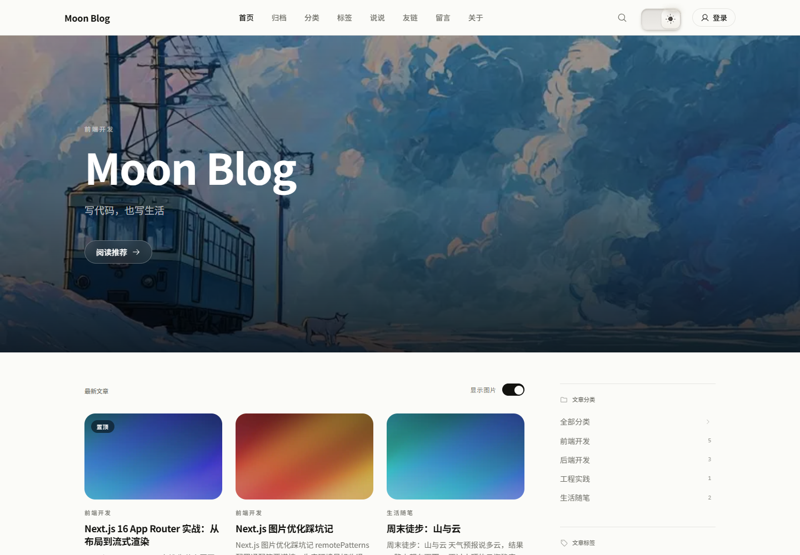
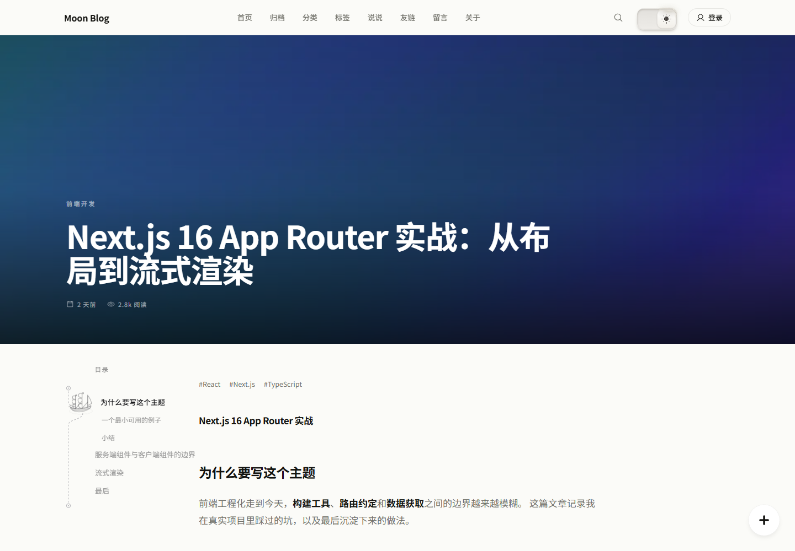
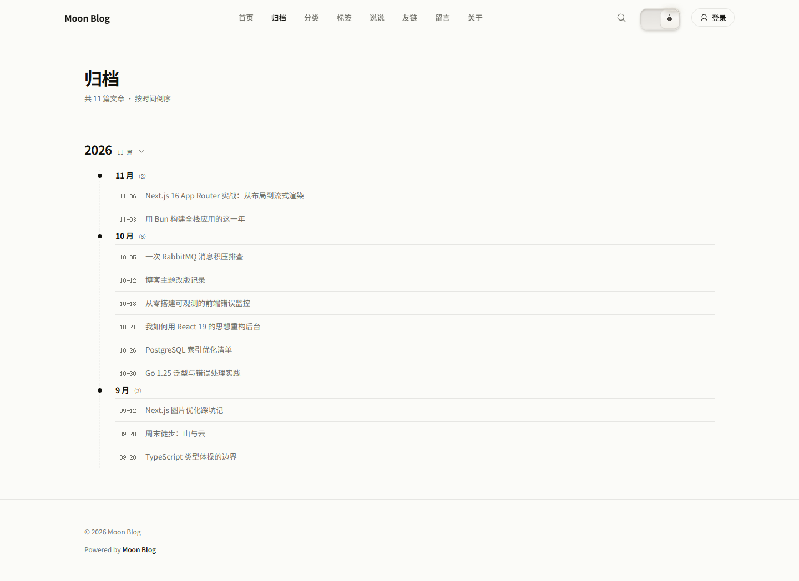
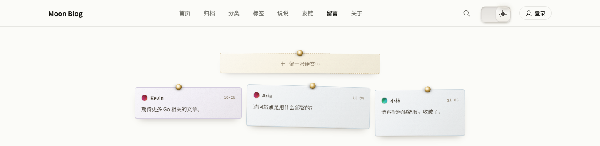
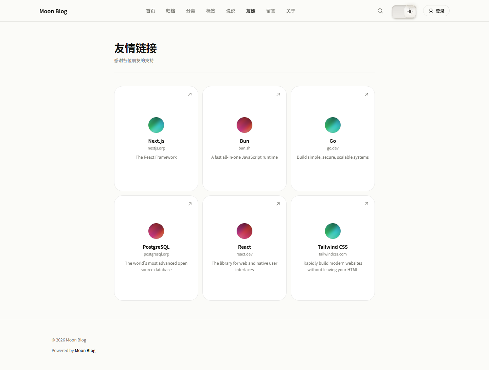
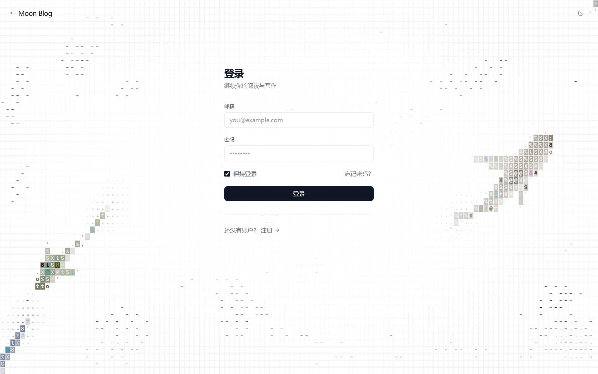
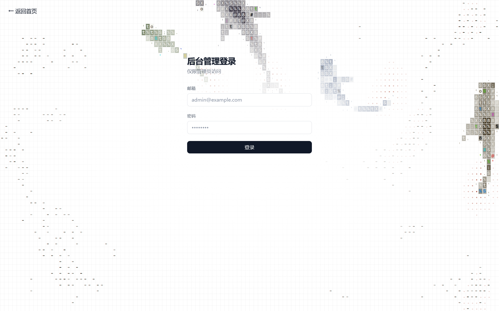
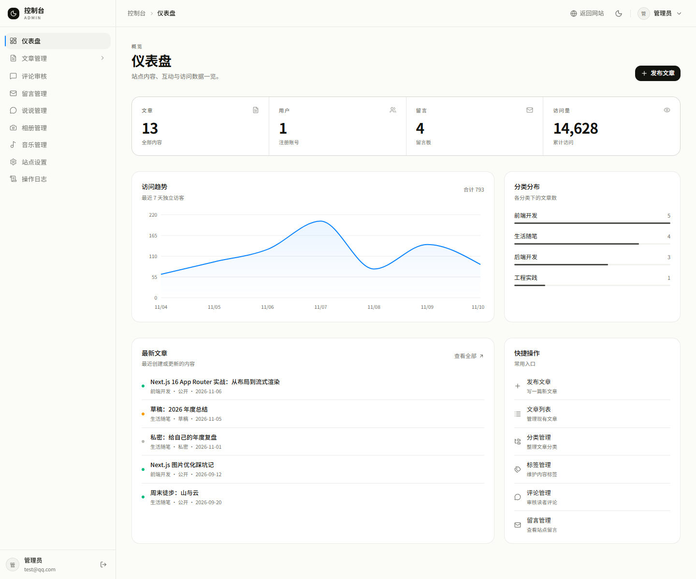
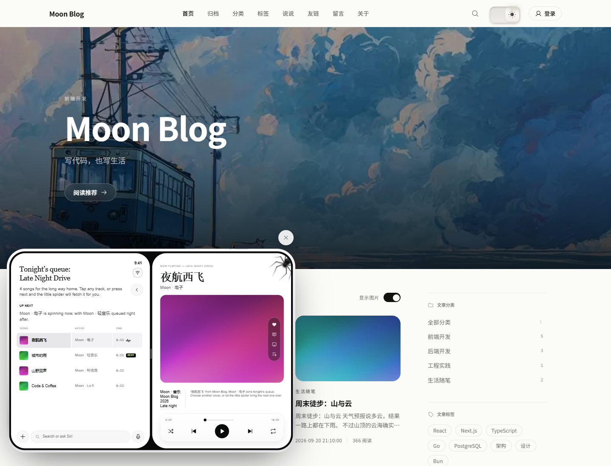
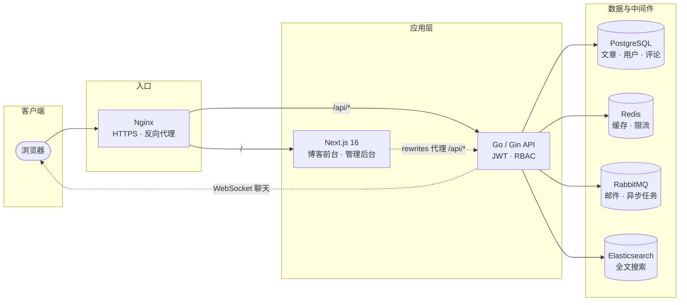

<div align="center">

# 🌙 Moon Blog

**一个自己写的全栈个人博客 —— 极简排版的前台，配上够用的后台**

[](LICENSE)
[](https://nextjs.org)
[](https://react.dev)
[](https://go.dev)
[](https://www.postgresql.org)
[](https://www.docker.com)

</div>



## 页面预览

<table>
  <tr>
    <td width="50%"></td>
    <td width="50%"></td>
  </tr>
  <tr>
    <td></td>
    <td></td>
  </tr>
  <tr>
    <td></td>
    <td></td>
  </tr>
</table>





## 功能

- **前台**：Hero 推荐、文章列表、分类 / 标签筛选、归档、说说、留言板、友链、相册、全文搜索
- **阅读体验**：Markdown 渲染与代码高亮、文章目录、图片灯箱、深浅主题、蜘蛛点唱机
- **后台**：仪表盘、Markdown 文章编辑、评论 / 留言审核、分类标签、相册、音乐管理、站点配置、操作日志
- **服务端**：JWT + Casbin RBAC、Redis 限流、RabbitMQ 异步任务、Elasticsearch 搜索、WebSocket 聊天

## 技术栈

| | |
| --- | --- |
| 前端 | Next.js 16 (App Router) · React 19 · TypeScript · Tailwind CSS v4 · Base UI · Phosphor Icons |
| 后端 | Go · Gin · GORM · Casbin · JWT |
| 数据 | PostgreSQL 16 · Redis 7 · Elasticsearch 7 · RabbitMQ |

## 架构



> 本地开发不经过 Nginx：浏览器访问 Next.js（`:3000`），由 `rewrites` 把 `/api/*` 转发到 Go 服务（`:8080`）。

## 快速开始

### Docker 一键启动

```bash
git clone https://github.com/imagist13/MoonCode.git
cd MoonCode

cp .env.example .env          # 填好 JWT_SECRET、数据库密码等
docker compose up -d --build
```

启动后访问：

- 博客前台：<http://localhost:3000>
- 后端健康检查：<http://localhost:8080/health>
- RabbitMQ 控制台：<http://localhost:15672>（guest / guest）

首次使用需要创建管理员：

```bash
docker compose exec -e SEED_ADMIN_EMAIL=admin@example.com \
                    -e SEED_ADMIN_PASSWORD='your-password' \
                    backend ./seed
```

### 本地开发

```bash
# 只启动依赖服务
docker compose up -d postgres redis rabbitmq elasticsearch

# 后端（:8080）
cd backend
JWT_SECRET="$(openssl rand -base64 48)" go run ./cmd/server

# 前端（:3000）
cd frontend
bun install && bun run dev
```

前端通过 `next.config.ts` 的 rewrites 把 `/api/*` 代理到 `BACKEND_URL`（默认 `http://localhost:8080`），本地开发不用处理跨域。

## 项目结构

```
MoonCode/
├── frontend/    # Next.js 16：博客前台 + 管理后台（见 frontend/README.md）
├── backend/     # Go + Gin：API、权限、搜索、消息队列（见 backend/README.md）
├── scripts/     # 开发脚本：页面截图（见 scripts/README.md）
├── deploy/      # Nginx 配置、生产 compose、部署文档
└── docker-compose.yml
```

## 部署

生产部署（Nginx + HTTPS + 自动发布 + 备份回滚）见 [`deploy/DEPLOY.md`](deploy/DEPLOY.md)。

## License

[MIT](LICENSE)
